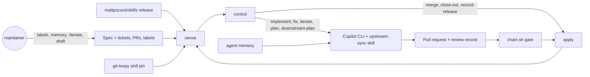

# The upstream-sync loop

A scheduled control loop that keeps this repository's skills synced with
[mattpocock/skills](https://github.com/mattpocock/skills) releases, then moves
[git-loopy](https://github.com/bradcstevens/git-loopy)'s skill pin behind each completed sync. It
works one small, reviewed pull request at a time, and a maintainer steers it from the issue
tracker, a memory file and `/iterate`.

## Set point

- **Here:** every in-scope change up to the latest upstream *release* is carried, and the only
  remaining differences from upstream are the overlays
  [`sync-rules.md`](../.github/skills/upstream-sync/references/sync-rules.md) names.
- **In git-loopy:** `skill_source.json` pins a proved revision of this repository that contains
  the last completed sync, moved in git-loopy's order: publish, prove, pin last (its ADR-0064).
- **Scope:** upstream's `engineering/` and `productivity/` buckets, plus the upstream skills
  [`.github/upstream-sync.json`](../.github/upstream-sync.json) maps or lists. The rest of `misc/`
  and `in-progress/` is reported, never ticketed.

## The loop



### Sensor

`scripts/upstream-sync.py sense` reads GitHub through `gh` and writes nothing. It reports:

- the latest upstream release, resolved to its commit;
- the sync specs, found by the `upstream-sync` label and a hidden marker,
  `<!-- upstream-sync:spec target=<sha> release=<tag> -->`, with their tickets (native
  sub-issues: labels, blockers, assignees, attempts);
- the last completed sync, from the close-out marker on the closed spec;
- the release gap: whether the open spec's target, or else the last sync, already contains the
  latest release. When it does not, the sensor classifies every upstream skill as added, modified,
  removed, moved or deprecated, by comparing the two upstream trees, and applies the scope gate;
- claims: open pull requests that close a ticket, and branches named `ticket/<n>-...` or
  `.../issue-<n>` committed to in the last `branch_claim_days`;
- open loop pull requests in both repositories, each with its ticket's state, its `chain.sh gate`
  verdict, fix attempts and unanswered `/iterate` comments;
- git-loopy's pin, and whether it contains the last sync.

Both repositories are public, so anyone can comment. A marker counts only when the token's own
account wrote it, and an issue-body marker only when the issue's author holds one of the
`trusted_associations`.

### Controller

`scripts/upstream-sync.py control` is a pure function of the sensor output, tested offline by
`scripts/test-upstream-sync.py`. Each run takes the first action that applies:

| # | When | Action |
| --- | --- | --- |
| 1 | A loop PR's ticket was closed | `abandon`: close the PR with a comment |
| 2 | A loop PR has an unanswered `/iterate` | `iterate` |
| 3 | A loop PR passes the merge gate | `merge` (merge commit here, squash in git-loopy) |
| 4 | A loop PR is a draft, its checks are running, or mergeability is unknown | `wait` |
| 5 | A loop PR is conflicted, red or unreviewed | `fix`, at most `max_fix_attempts`, then `blocked` |
| 6 | An open `upstream-sync` blocker issue exists | `blocked` |
| 7 | Every ticket of an open spec is closed | `close-out` |
| 8 | The last sync is not in git-loopy's pin | `implement` its ready ticket there, or `downstream-plan` one |
| 9 | An open spec has an eligible ticket | `implement` (`priority` first, then oldest) |
| 10 | A release is past the baseline | `plan` if it changes an in-scope skill, else `record-release` |
| 11 | Otherwise | `none` |

A ticket is eligible when it is open, `ready-for-agent` without `ready-for-human`, has both
`## What to build` and `## Acceptance criteria`, has no open blocker, no assignee and no claim, and
has had fewer than `max_ticket_attempts` loop attempts. The same rule picks git-loopy's ticket.

At most one loop pull request is open at a time, across both repositories.

### Actuator

The [GitHub Copilot CLI](https://docs.github.com/copilot/how-tos/copilot-cli), run headless with
the model, effort and context pinned from `git-loopy.env`, and the
[`upstream-sync` skill](../.github/skills/upstream-sync/SKILL.md). The skill drives this
repository's own skills through the skill tool:

- **`implement`:** `/implement`, open the pull request, then `/code-review`, which records the
  findings or a `review-clean: head=<sha>` line on the ticket.
- **`fix`:** `/implement` resolves the conflict, the red check or the review findings, and closes
  with a review of the new head.
- **`iterate`:** apply the maintainer's feedback and distill durable guidance into memory.
- **`plan`:** `/to-spec` and `/to-tickets` for a new release, plus a follow-up issue in git-loopy.
- **`downstream-plan`:** `/to-tickets` in git-loopy for the pin move.

In CI the catalog is copied, never linked, into the agent's skill root, so a ticket that edits
`/implement` cannot change the skill doing the work.

### Merge

Deterministic. The workflow merges only when `skills/next/chain.sh gate` allows: GitHub reports
the pull request mergeable, the ticket carries a `review-clean` record for the exact head, and
every check is green. Making a pull request a draft pauses it.

### Dampener

[`upstream-sync-compat.yml`](../.github/workflows/upstream-sync-compat.yml) runs git-loopy's
`python -m git_loopy.skill_candidate` against every pull request here, judged by git-loopy's
`main`. When a change would break git-loopy's contract (a Required Skill, a documented Skill
reference, the label vocabulary), it warns and leaves a sticky comment. It never fails, because
git-loopy adapts in the per-sync pin move rather than in the pull request that broke it.

## Run it locally

Each piece runs on its own, with your signed-in `gh` and `copilot`. Nothing below writes to GitHub
until `start`, `apply` or `finish`.

```bash
python3 scripts/upstream-sync.py sense --out /tmp/sensor.json        # measure
python3 scripts/upstream-sync.py control /tmp/sensor.json            # decide
python3 scripts/upstream-sync.py shepherd --dry-run                  # both, plus what apply would do
python3 scripts/test-upstream-sync.py                                # the controller's tests
```

To run the actuator on the controller's choice, in a scratch directory:

```bash
python3 scripts/upstream-sync.py control /tmp/sensor.json --out /tmp/decision.json
python3 scripts/upstream-sync.py start /tmp/decision.json --root /tmp/upstream-sync --out /tmp/workspace.json
python3 scripts/upstream-sync.py prompt /tmp/decision.json --workspace /tmp/workspace.json > /tmp/agent-prompt.md
source git-loopy.env
cd "$(jq -r .work /tmp/workspace.json)"
copilot -p "$(cat /tmp/agent-prompt.md)" --model "$GIT_LOOPY_MODEL" --reasoning-effort "$GIT_LOOPY_EFFORT" \
  --context "$GIT_LOOPY_CONTEXT" --allow-all --no-ask-user --no-color --output-format json \
  --share /tmp/agent-session.md --add-dir <this checkout> > /tmp/agent-output.jsonl
grep '^{' /tmp/agent-output.jsonl \
  | jq -rs '[.[] | select(.type == "assistant.message" and (.data.content // "") != "")] | last | .data.content // empty' \
  > /tmp/agent-message.md
python3 <this checkout>/scripts/upstream-sync.py finish /tmp/decision.json --body /tmp/agent-message.md
```

`start` makes its own clones under `--root`, so your working copy, its uncommitted edits and its
chain ledger are never touched. Leave out `--install-skills` locally: your installed skills stay
as they are, and `--add-dir` loads the loop's skill from this checkout.

## Credentials

The workflow authenticates with one fine-grained personal access token, stored in this repository
as the Actions secret `UPSTREAM_SYNC_TOKEN`. A token, not the workflow's `GITHUB_TOKEN`, because
the loop opens pull requests in git-loopy too, and because pull requests opened with
`GITHUB_TOKEN` trigger no checks, which the merge gate would refuse forever.

1. Create the token at
   [github.com/settings/personal-access-tokens/new](https://github.com/settings/personal-access-tokens/new):
   resource owner `bradcstevens`; repositories `git-loopy-skills` and `git-loopy`; repository
   permissions **Contents**, **Issues**, **Pull requests** and **Workflows**, all read and write;
   account permission **Copilot Requests**.
2. Store it: `gh secret set UPSTREAM_SYNC_TOKEN --repo bradcstevens/git-loopy-skills`.
3. Renew it before it expires. Without it, scheduled and `/iterate` runs skip with a warning, and
   a manual run fails.

Copilot usage bills to the token owner's seat.

## Steering

- **Memory:** [`.github/agent-memory/upstream-sync.md`](../.github/agent-memory/upstream-sync.md)
  is loaded into every run after the controller. Put durable guidance there: scope exclusions,
  false positives, reviewer preferences.
- **Scope and limits:** [`.github/upstream-sync.json`](../.github/upstream-sync.json): the in-scope
  buckets, renames, labels, merge methods and attempt limits.
- **Selection:** the loop takes only `ready-for-agent` tickets. Add `priority` to go first, assign
  yourself to reserve a ticket, or swap in `ready-for-human` to keep it from the loop. A ticket the
  loop fails twice moves to `ready-for-human` on its own.
- **A pull request:** comment `/iterate <feedback>`, or make it a draft to pause it. After
  `max_fix_attempts` failed fixes the loop comments and stops touching it until you do. Close a
  ticket and the loop closes its pull request. On a git-loopy pull request, `/iterate` waits for the
  next scheduled run, and any memory entry it proposes is quoted in the reply for you to add here.
- **Pausing:** an open issue labelled `upstream-sync` whose body carries
  `<!-- upstream-sync:blocked -->` pauses new work. The loop opens one when planning fails; close
  it to resume.
- **Manual runs:** dispatch the workflow with `ticket` to implement a specific issue now (an
  override: it skips the one-open-PR bound), or with `dry_run` to see what it would do.

## Disturbances

- **Other agents and maintainers** work the same tickets from their own worktrees. Their pull
  requests and fresh branches are claims, and the loop skips claimed tickets.
- **Concurrent merges** move `main` under an open loop pull request. The gate sees the conflict,
  and the next run fixes it; `README.md`'s skill index is always regenerated, never hand-merged.
- **A release that lands mid-sync** waits: each spec syncs to its own pin, and the next spec starts
  from it.
- **git-loopy moving its own pin, or its contract**, shows up in the dampener and in the
  downstream proof.

## Tuning

Start from the outputs: the run summary (every decision and why), the `agent-output` artifact (the
prompt, the decision, the transcript), and the pull requests themselves. Tighten the controller in
`scripts/upstream-sync.py` and its tests, the judgement in the skill, and the steering in memory.
Once runs are consistently clean, raise the cadence (`17 */6 * * *` in
[`agent-upstream-sync.yml`](../.github/workflows/agent-upstream-sync.yml)).
